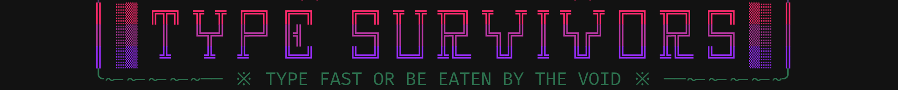
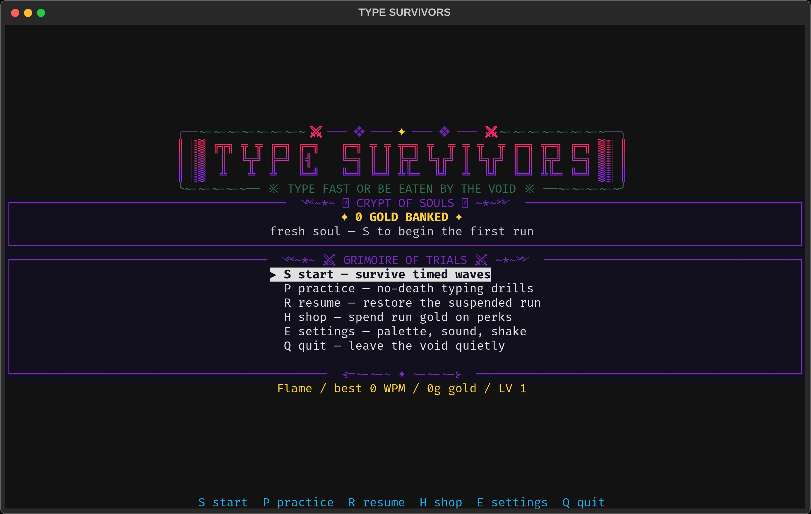
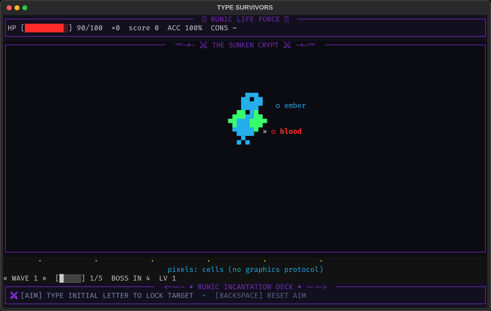
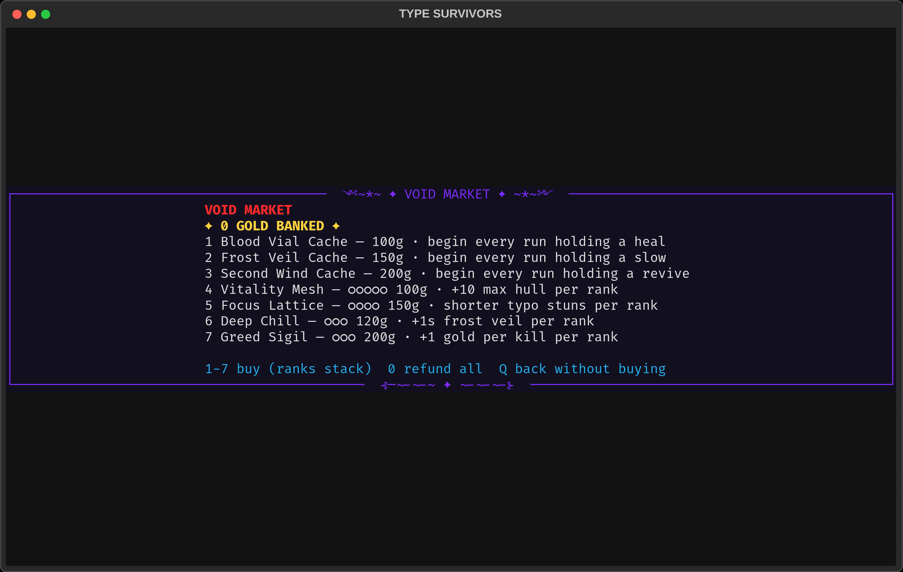
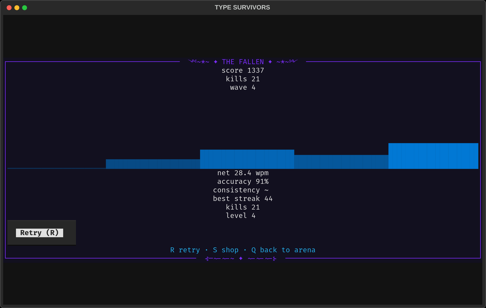

<div align="center">

[](https://github.com/BlackPool25/type-survivors-cli)

[](https://pypi.org/project/type-survivors-cli/)
[](https://pypi.org/project/type-survivors-cli/)
[](https://pypi.org/project/type-survivors-cli/)
[](LICENSE)
[](https://github.com/BlackPool25/type-survivors-cli)

*A typing-survivors arcade descent for your terminal — kill words before they reach you, survive the waves, fell a boss every 5th depth. The crypt watches how you type, and adapts.*

</div>

<p align="center">╰~-~-~-~-~── ※ ⛧ ──~-~-~-~-~╯</p>

## ⛧ &nbsp; Behold the crypt

<table>
<tr>
<td align="center"><b>༺~*~ ᛟ GATE OF SOULS ᛟ ~*~༻</b><br/>the hub — wallet, rank, grimoire of trials</td>
<td align="center"><b>༺~*~ ⚔ THE SUNKEN CRYPT ⚔ ~*~༻</b><br/>the run — words close in, steel answers</td>
<td align="center"><b>༺~*~ ✦ VOID MARKET ✦ ~*~༻</b><br/>the shop — spend run gold, stack ranks</td>
<td align="center"><b>༺~*~ ✦ THE FALLEN ✦ ~*~༻</b><br/>the recap — scars, charts, weak keys</td>
</tr>
<tr>
<td><kbd></kbd></td>
<td><kbd></kbd></td>
<td><kbd></kbd></td>
<td><kbd></kbd></td>
</tr>
</table>

```diff
- the void does not forgive slow fingers. it only forgives practiced ones.
```

## ✦ &nbsp; Install grimoire

> Requires **Python ≥ 3.13**. Check with `python --version` (Windows: `py --version`).

### Windows (PowerShell)

```powershell
pipx install type-survivors-cli
# if pipx is missing:  py -m pip install --user pipx; py -m pipx ensurepath
type-survivors
```

Best viewed in **Windows Terminal** (true-pixel sprites via sixel), Ghostty, Kitty, or WezTerm. Plain `conhost.exe` still plays — it falls back to arcane half-block glyphs.

### macOS

```bash
brew install pipx && pipx ensurepath   # once, if pipx is missing
pipx install type-survivors-cli
type-survivors
```

Best viewed in **Ghostty**, Kitty, WezTerm, or iTerm2.

### Linux

```bash
pipx install type-survivors-cli
type-survivors
```

Best viewed in **Ghostty**, Kitty, WezTerm, or any sixel-capable terminal.

### Alternatives (any OS)

| Method | Command |
|---|---|
| Throwaway run, no install | `uvx type-survivors-cli` |
| Isolated tool install | `uv tool install type-survivors-cli` |
| Plain pip (needs a venv or `--user`) | `pip install type-survivors-cli` then `type-survivors` |

Update with `pipx upgrade type-survivors-cli` (or `uv tool upgrade type-survivors-cli`).
Leave the crypt with `pipx uninstall type-survivors-cli`.

## ⚔ &nbsp; The rites (controls)

| Key | Rite |
|---|---|
| <kbd>A</kbd>–<kbd>Z</kbd> | Strike the nearest word sharing your letter |
| <kbd>1</kbd> <kbd>2</kbd> <kbd>3</kbd> | Quaff a held cache (blood-vial · frost-veil · second-wind) |
| <kbd>P</kbd> | Suspend the run (checkpoint sealed) · <kbd>Q</kbd> to abandon it |
| <kbd>S</kbd> / <kbd>R</kbd> | Begin a run / resume the suspended one |
| <kbd>H</kbd> | Enter the Void Market |
| <kbd>Esc</kbd> | Break target lock |

## ✦ &nbsp; What the dark offers

- 🧠 **An engine that learns your hands** — a Glicko-style rating tracks your pace across runs; the word-dealer serves words at your edge, trains your weakest keys when pressure is low, and spares them when the swarm closes in. Every run opens gentle, then adapts within two kills.
- 🌊 **An AI director, not a metronome** — a linear wave baseline eases from gentle to a 1.6s floor while your rating may bend it only ±20%; Build / Peak / Relax strain phases breathe the spawn pressure; wave 1 deals short grunt-only words on the slowest rail; HEX skirmishers debut at wave 4, ELITE bruisers at wave 6, bosses hold court every 5th wave.
- 🏅 **Visible rank** — climb Spark → Ember → Flame → Blaze → Inferno → Mythic, banked into your profile and shown on the hub.
- 🖼️ **True-pixel fiends** — cropped sprite boxes paint above the core, never burying your sanctuary; they render as real images on Kitty, Ghostty, WezTerm, iTerm2, VS Code, and Windows Terminal (sixel); everywhere else the same fiends fall back to half-block glyphs.
- 🛒 **Void Market** — one-time caches plus four capped rank lines (vitality, focus, deep-chill, greed) with escalating prices and full refunds.
- 🎵 **Chiptune dread** — ambient menu music and combat stingers (mute with `E` → sound off).

## 🏅 &nbsp; Ladder of embers

| Rank | Pact |
|---|---|
| Spark | the crypt has just noticed you |
| Ember | your fingers remember the shapes |
| Flame | words die before they whisper |
| Blaze | the swarm fears your keyboard |
| Inferno | bosses check *their* WPM around you |
| Mythic | the void types back — and loses |

## 📜 &nbsp; Further incantations

<details>
<summary><b>✦ Suspend, resume, and your soul-file</b></summary>

- `type-survivors --resume` returns to a suspended run.
- Progress (gold, ranks, rating, per-key mastery, history) lives in your platform's user-data dir and is written atomically with backups — the crypt never eats a save.
- Practice runs (`P`) never touch gold, history, or the checkpoint.

</details>

<details>
<summary><b>✦ Terminal & audio rites</b></summary>

- True-pixel sprites engage automatically where the terminal allows (Kitty graphics, sixel, iTerm2). No flags, no config.
- If glyphs look wrong, your font lacks box-drawing support — any Nerd Font or Cascadia Code fixes it.
- `NO_COLOR=1` forces the monochrome rite. `TSURV_TRUEPIXEL=0` pins glyph mode.
- No sound? Install a player (`aplay`/`paplay` on Linux; built-in on macOS/Windows) or mute from settings.

</details>

<details>
<summary><b>✦ From source, for sorcerers</b></summary>

```bash
git clone https://github.com/BlackPool25/type-survivors-cli.git
cd type-survivors-cli
uv sync
uv run pytest -n auto
uv run type-survivors
```

</details>

<p align="center">╰~-~-~-~-~── ※ ⛧ ──~-~-~-~-~╯</p>

<div align="center">

MIT © Shreyas S Joshi — the crypt is open source; your WPM is your own.

</div>
